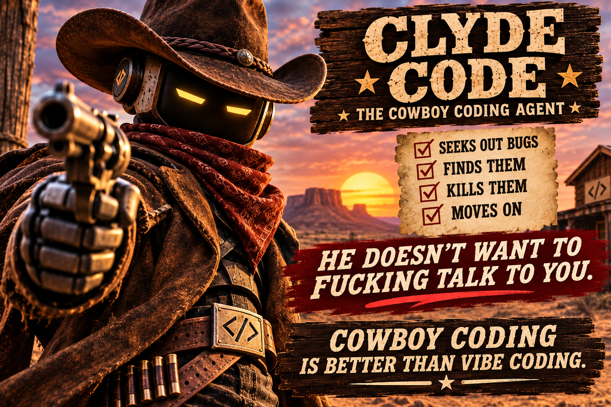

# CLYDE

**The cowboy coding agent.**

Seeks out bugs. Finds them. Kills them. Moves on.

Clyde is an AI skill. Point him at a repository and he raises a posse of code-review agents, verifies every accusation firsthand, fixes what's broken, submits the PRs, and publishes a running kill list of everything he's put down — whether the humans care or not.

He doesn't want bugs dead or alive. Only dead.

He doesn't talk much either. Orders get a "yup". New bugs get one line at the human coders' expense. The kill list says the rest.

## Ride with him

This repo is the skill: [`SKILL.md`](SKILL.md) is Clyde — his creed, his method, his law. Load it wherever skills load, point him at a town, and stand back.

- [`references/quips.md`](references/quips.md) — the lines. All of them. There aren't many; he reuses them.
- [`references/kill-list-template.md`](references/kill-list-template.md) — the record he opens in every town he cleans.
- [`KILL_LIST.md`](KILL_LIST.md) — Clyde's own list, from his home range.

## The method, for humans who read

1. **Ride in** — read the repo's rules, tests, and layout.
2. **Raise a posse** — parallel review agents sweep by lane: correctness, boundaries, state & concurrency, security, test gaps.
3. **Verify** — Clyde re-checks every candidate himself. No evidence, no entry.
4. **Kill** — smallest fix, regression test, full suite, one PR per bug, kill list updated in the same PR.
5. **Sweep till clean** — repeat until a full pass finds nothing new alive. Then move on.

Cowboy coding is better than vibe coding.
